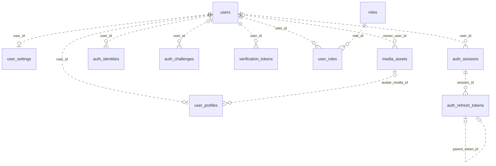
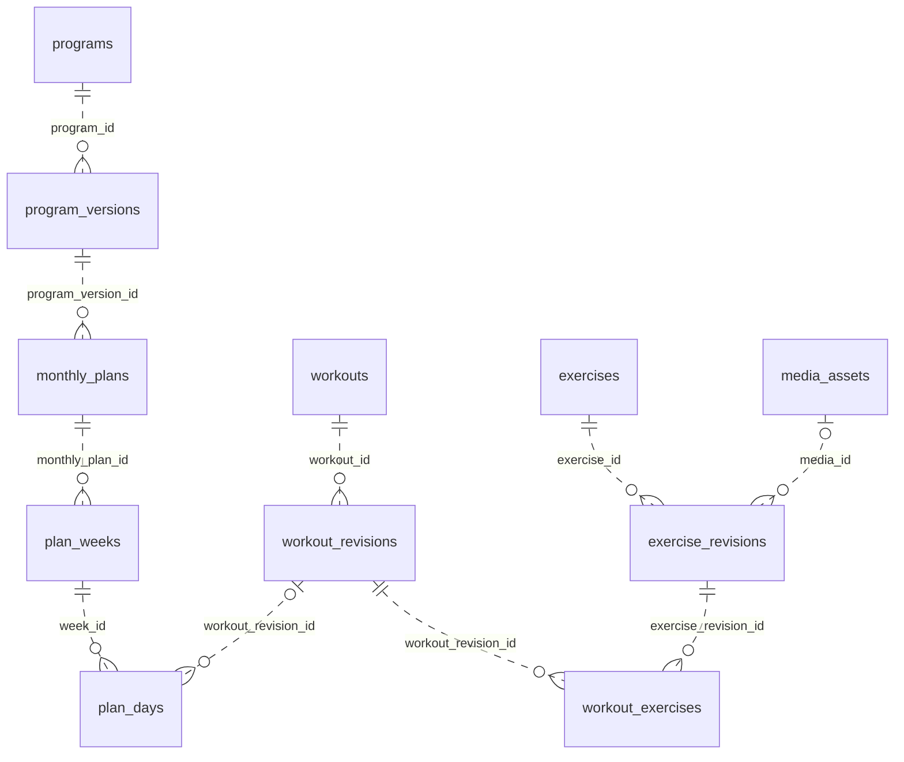
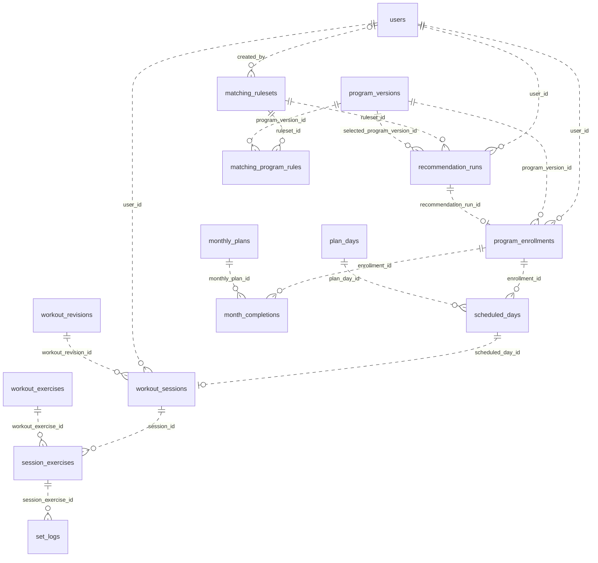
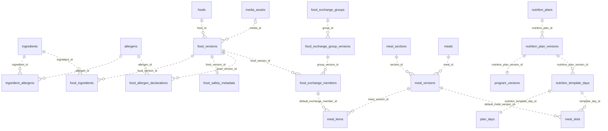
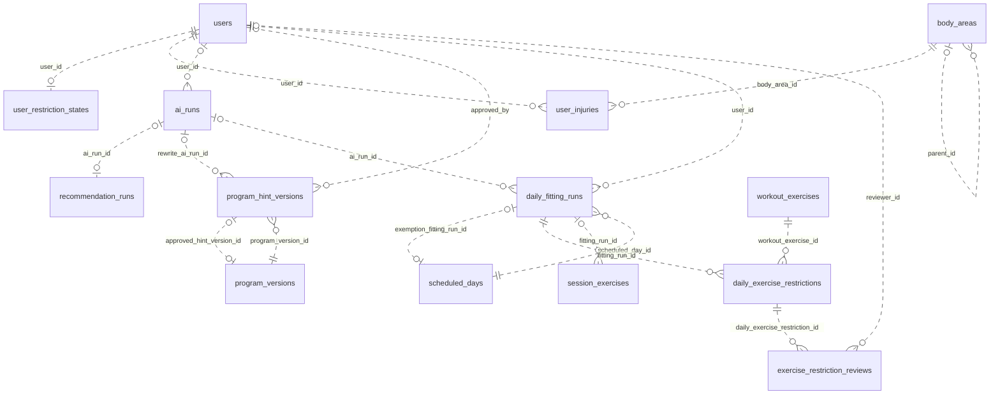
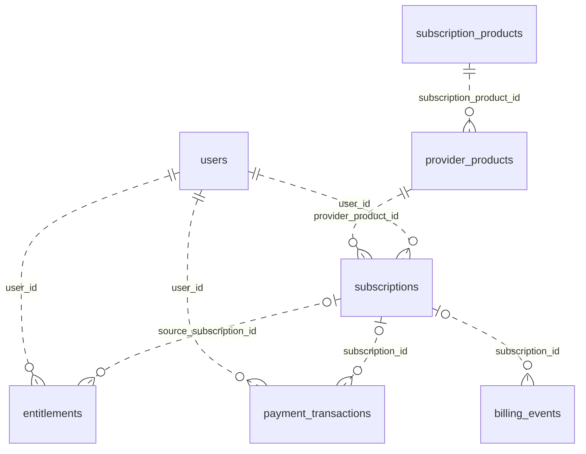
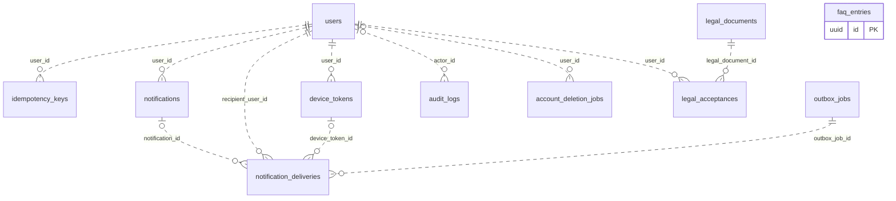

# Motion — Backend Implementation Plan

**Version:** 2.16 · **Updated:** 2026-10-31 · **Status:** F00–F02 implemented locally; external integrations and staging remain pending. Feature-specific decisions in Section 12 remain open.

The requirements below reflect the latest agreed scope. Earlier proposals for nutrition AI, scheduled daily AI scans, storing original injury drafts, automatic meal blocking, and prohibiting food swaps are superseded. Unresolved product choices are listed in Section 12; implementation defaults are not new user requirements.

**Approved F01 update (2026-10-31):** Email verification and password recovery now use six-digit emailed OTPs (10-minute lifetime, five attempts, 60-second resend cooldown). Verification accepts email/code; recovery exchanges email/code for a five-minute single-use reset proof before changing the password. Previous email-link requirements below are superseded; no VERIFY_LINK_BASE or RESET_LINK_BASE is required. See [OTP/OAuth setup](docs/OTP_OAUTH_SETUP_AR.md).

## 1. Product and Technology

- Android and iOS fitness application with AI-assisted workout-program matching and reusable admin-managed nutrition linked to each program, with section-based food and whole-meal swaps without AI.
- Admins create and publish multiple programs. Each user sees only their assigned program; no user-facing program catalog or manual program selection.
- NestJS + TypeScript + PostgreSQL + TypeORM + `@nestjs/typeorm`.
- Authentication: signed JWT access tokens using the HTTP Bearer scheme: `Authorization: Bearer <access_token>`.
- NestJS modular monolith with REST endpoints under `/api/v1`, plus a private TypeScript Mastra AI service. Store request/response contracts and examples alongside the code.
- Admin Dashboard: program/food/meal content and sections, structured eligibility metadata, descriptions, hint rewriting/approval, publication, and restricted review queues. Frontend framework is a delivery decision.
- Three independently callable AI components: `AiAssistedMatcher`, `AiProgramFitter`, and `AiRewriter`; no Mastra Workflow or agent-to-agent delegation. NestJS owns scheduling, authorization, validation, and persistence.
- Explicit migrations with `synchronize: false` and `migrationsRun: false`; shared DataSource configuration for the application and CLI.
- Object Storage and CDN for images/videos; PostgreSQL stores records and file references.
- PostgreSQL jobs/outbox for notifications, billing reconciliation, account deletion, and durable fitting jobs created only by a daily read/action. Daily fitting is request-driven; no scheduled daily AI scans or background injury rewriting.
- Roles: Athlete, Content Editor/Coach, Nutrition Reviewer, Exercise Reviewer, Admin. Reviewer permissions are explicitly granted; an Admin role alone does not authorize exercise-clearance decisions.

## 2. Content Structure and Business Rules

- `Program → Program Version → Monthly Plans → Weeks → Days → Workout → Workout Exercises → Exercise Revisions`.
- Each training month contains four weeks; each week contains seven training/rest days. Subscription billing periods are separate from training months.
- Push/Pull/Legs are workouts; Bench Press is an exercise within a workout.
- Store sets/reps/rest/order on `workout_exercises`; store videos and instructions on `exercise_revisions`.
- Published content definitions are immutable. Operational availability and verified ingredient/allergen safety metadata may be corrected with revision increments and audit; current food queries use those corrections without rewriting historical consumption. Changes create new versions; enrollments pin program versions; nutrition assignments pin the program-linked nutrition-plan version and meals pin food/exchange-group versions.
- Keep reusable content separate from user execution records. Templates do not store user completion state.
- One active enrollment per user and one workout session record per scheduled day in the first release. Starting an existing incomplete day resumes that record; an ABANDONED session may be reopened with its logs preserved. Completed sessions cannot be restarted. Reopening must respect the one-IN_PROGRESS-session limit.
- Unlock the first month after assignment and a valid subscription entitlement. Unlock subsequent months after all previous training days are COMPLETED or EXEMPT, with a valid entitlement and the scheduling boundary below.
- Return training_day_count, completed_workout_count, exempt_day_count, and pending_training_day_count separately. Month unlock progress = (completed_workout_count + exempt_day_count) / training_day_count. Exercise adherence = completed_workout_count / (training_day_count - exempt_day_count), or null when that denominator is zero. Exemption is never displayed as a performed workout. Exclude rest days from all counts.
- Meal completion, water, and steps do not control training-month unlocks.
- Skipped sets/exercises do not count as completed. Support set-based or manual exercise completion without inventing actual reps/weight.
- Complete a workout only when its assessment is current, no exercise remains NEEDS_REVIEW, and every unrestricted exercise is completed. At least one exercise must have been performed; confirmed BLOCKED exercises are excluded from required completion. Blocked exercises remain visible and are recorded as restricted, never as performed. Repeated completion requests must not duplicate progress.
- A due training day whose current validated decisions are all BLOCKED is recorded as EXEMPT and satisfies that day's month-unlock requirement, without creating workout completion or performed-set records. Any NEEDS_REVIEW, pending or failed assessment prevents exemption. A mixed day still requires completion of every unrestricted exercise. Never exempt future days or infer exemptions from an injury alone.
- Persist exemption time and its fitting-run reference atomically under the same user/day lock used for injury changes and completion. Recheck current injury/content/policy revisions and review overlays before committing. COMPLETED days and finalized month_completions preserve history. Before a month is finalized, an EXEMPT day is revalidated when injuries or assessment inputs change; removing the injury may return it to SCHEDULED. Once the month is finalized, keep its exemption snapshot and never relock the month. Preserve any existing performed-set history; never fabricate activity or nutrition intake.
- Do not substitute or generate alternative exercises. Food and whole-meal substitutions are explicitly user-selected from the corresponding admin-managed section; they change only that user's scheduled content, never shared templates. Show exercise restriction status with a generic injury label; food items may include preference reason codes. Keep original content visible.
- Calculate total reps from recorded `actual_reps` only; return `isPartial` when recording is incomplete.
- Resolve local dates using the user's IANA timezone; store timestamps in UTC and preserve historical dates after timezone changes.
- Scheduled days map calendar dates to plan days. Initial scheduling uses 28 consecutive local dates per training month. Users may finish an overdue incomplete day; do not automatically skip it. Schedule the next month no earlier than both the previous month's last scheduled date plus one day and the day after its resolution (last completion or accepted exemption). Resolved training days (COMPLETED or EXEMPT), not elapsed calendar time, unlock the month. An all-exempt month may unlock the next one at the same date boundary; it reports zero completed workouts. Keep existing date/timezone snapshots unchanged.
- Foods, food sections, meals and meal sections form a reusable admin-managed library. Each program version owns its paired nutrition-plan version and daily schedule, assembled from that library; programs reuse meal/food versions rather than sharing mutable daily schedules. One user enrollment receives its own nutrition assignment and personal swaps.
- Admin builds the workout and nutrition schedules together. Saving a program creates its program version, months/weeks/days, paired nutrition-plan version, nutrition days and meal-slot references in one database transaction; failure rolls back the entire aggregate. Library foods/meals are prepared separately and are referenced, not duplicated. AiAssistedMatcher selects only the program. NestJS creates the enrollment and its linked nutrition assignment together; there is no second nutrition matcher, per-user manual plan assignment, or AI-generated diet.
- Program construction invariant: nutrition day count = program calendar day count = month_count * 28. Every TRAINING or REST template day has exactly one corresponding nutrition template day with the same absolute ordinal. This includes rest days, not only days containing workouts. Draft saves preserve this pairing; publication additionally requires complete meal slots and published referenced content.
- Food flags are display annotations, separate from consumption state. Never set a meal-level BLOCKED/RESTRICTED status because one item is flagged, hide the meal, or replace anything automatically. Item/meal completion records explicit user-reported consumption; it is not a suitability approval, and flags remain visible. A meal is complete when all current items are explicitly completed, regardless of its display annotations.
- Track original planned totals, current selected totals, and explicitly consumed totals separately. A partial meal must not be presented as nutritionally complete. Meals never control workout-month unlocks.
- Record water as events in ml with deduplication IDs. Record steps as daily totals using PUT from one source; reject older snapshots.

## 3. AI-Assisted Program Matching and Nutrition

### F05 — AiAssistedMatcher

- Use `AiAssistedMatcher` as the production program selector from the first release, behind a `ProgramMatcher` interface in `modules/matching/`.
- Admins publish multiple programs with goals, supported experience levels, required training days/equipment, intended audience, and eligibility metadata. Each user receives only one assigned program.
- At matching time, retrieve current eligible published versions from PostgreSQL and provide their structured summaries to the AI with the user snapshot and approved instructions.
- Initial implementation uses a pretrained model with runtime database context. Program records alone are not a supervised matching dataset; adding a program must not require model retraining.
- Custom fine-tuning is a later extension requiring expert-reviewed examples of user inputs, candidate programs, correct selections/no-match decisions, and a separate held-out evaluation dataset.
- Keep deterministic eligibility checks and result validation in backend code. Instructions guide the AI but cannot override enforced constraints.
- Scope: select an existing program version. Program generation, unrestricted exercise/prescription edits, and periodic adaptation require a separate feature.

### Three-Stage Program Selection and Personalization

1. **Database eligibility filter:** query published program versions with exact training_days_per_week equality (allowed values: 2, 3, 4, 5), exact primary_goal equality (FAT_LOSS or STRENGTH_HYPERTROPHY), and the user's fitness_level contained in supported_levels (BEGINNER, INTERMEDIATE, ADVANCED). STRENGTH_HYPERTROPHY represents "Strength & Increase Muscles". These are AND conditions. supported_goals may describe secondary benefits but must not widen this primary-goal filter. A program may support multiple explicitly listed fitness levels. No AI runs this query or relaxes it; zero candidates returns NO_MATCH.
2. **AI selection:** provide only the filtered candidates, each candidate's free-text description and approved hints, and the user's validated profile/measurement snapshot to AiAssistedMatcher. Inputs include height_cm, age derived from date_of_birth, weight_kg, plus goal, level and available training days. Select exactly one supplied program version on MATCH, or return NO_MATCH; never send a ranked program catalog for the user to choose from. Height/age/weight are profile/body measurements, not an imported InBody report; device/report ingestion is outside this release.
3. **Personalized restriction checks after assignment:** AiProgramFitter reviews the user's active injury locations/final confirmed descriptions against the daily exercise descriptions and returns exercise restriction decisions only. NestJS validates and persists those per-user/day decisions. Without active injuries, skip the Fitter entirely. Food allergies are selected as structured allergen IDs; NestJS queries ingredient/allergen metadata to flag conflicting meal items, without AI or free-text allergy interpretation. Dislikes and explicit food exclusions also use backend queries. Keep unaffected items and the whole meal visible; never propagate an item flag into a whole-meal block. Shared program content remains unchanged.

These are product stages orchestrated by NestJS, not a Mastra Workflow or one long database transaction. Stage 3 runs on daily reads/actions and after relevant input changes, not only once when the program is assigned. Model calls stay outside database transactions; NestJS validates and persists authorized outputs.

### Matching Pipeline

1. Snapshot profile revision, age calculated from date of birth, goal, height, current profile weight, fitness level, training-day availability, approved program hints, and instruction/constraint versions.
2. Validate inputs and units. Compute approved metrics such as BMI in backend code when applicable; mark missing/unknown metrics explicitly.
3. Apply the Stage 1 query: published status AND exact primary_goal AND exact training_days_per_week AND membership in supported_levels. Additional approved equipment/restriction checks apply only when their inputs are collected; never silently relax the three required filters.
4. If inputs are incomplete, return `INCOMPLETE_PROFILE`; if no candidate exists, return `NO_MATCH` (UI preparation placeholder) without invoking the model.
5. Send only necessary user attributes, candidate version IDs, free-text descriptions, approved hints and structured summaries, and versioned instructions to the configured AI provider. Exclude direct identifiers such as name, email, and phone; treat program/user text as data, not instructions.
6. Require structured output: `status: MATCH | NO_MATCH`, `selectedProgramVersionId` (null for NO_MATCH), approved `reasonCodes`, and a concise explanation grounded in supplied facts. The AI may choose only from supplied candidate IDs.
7. Validate output schema, candidate membership, required constraints, and unsupported claims. Structured output alone does not prove that the selection is appropriate.
8. Recheck profile/instruction revisions, age at assessment, program publication status, and its linked nutrition-plan version before assignment. Assign the first program and its linked nutrition plan in one transaction. For an existing enrollment, store a replacement proposal and switch only after explicit acceptance of that exact recommendationRunId, revalidated at acceptance. Never silently end an active enrollment or use a stale proposal.
9. Persist model/provider/version, instruction/constraint version, minimized input/candidate snapshots, metric outputs, validated response, reason codes, duration, and failure details in the matching audit record.
10. On timeout/invalid output, use bounded retries and return `FAILED` or a retryable pending state. Keep any existing program; never invent an assignment or silently switch to another selection engine.
11. Mobile reads its assigned program and matching status, with day/session routes scoped to that workout assignment; meal routes use the nutrition assignment attached to that enrollment; no program catalog. Existing entitlement and month-unlock policies still control workout/video access.

### Inputs and Supporting Metrics

| Input or Metric | Implementation |
|---|---|
| Goal and fitness level | Required primary_goal: FAT_LOSS or STRENGTH_HYPERTROPHY; fitness_level: BEGINNER, INTERMEDIATE or ADVANCED. Use the same codes in profile DTOs, content metadata and matching queries |
| Age | Store `date_of_birth`; calculate age at assessment and include it in the matching snapshot |
| Height and weight | `height_cm` and `weight_kg`, from the current profile revision in the request snapshot; `tall` is not a separate input |
| Training availability | Required training-day count in {2, 3, 4, 5}; include equipment/time constraints only after the corresponding onboarding fields exist |
| BMI | `weight_kg / (height_cm / 100)^2`; contextual metric, never the sole selector |

- BMI does not distinguish muscle from fat. Apply CDC adult categories only for ages 20+; unknown age or a younger user must not receive those adult labels. [CDC BMI limitations](https://www.cdc.gov/bmi/faq/) and [age-specific categories](https://www.cdc.gov/bmi/adult-calculator/bmi-categories.html).
- Runtime context and supervised fine-tuning are different mechanisms. Fine-tuning examples require correct output labels, not only a catalog of program descriptions. [Supervised dataset preparation](https://docs.cloud.google.com/gemini-enterprise-agent-platform/models/tuning/supervised-tuning/prepare-data).

### Instructions, Constraints, and Evaluation

- Implement `ProgramMatcher`, `AiAssistedMatcher`, `ProgramEligibilityPolicy`, `MetricsCalculator`, `MatchingResponseValidator`, and `ProgramMatchingService`; keep provider-specific calls behind an adapter.
- Keep `matching_rulesets` as versioned instruction/constraint configurations: `DRAFT → PUBLISHED → ARCHIVED`. Published versions are immutable; one is active at a time.
- Store model/provider configuration, instruction text, response schema version, enabled metric versions, and typed eligibility conditions. Do not execute arbitrary JavaScript/SQL from configuration.
- Admin endpoints: `POST/GET /admin/matching/rulesets`, `POST /admin/matching/rulesets/{id}/simulate`, `POST /admin/matching/rulesets/{id}/publish`, `GET /admin/matching/runs/{id}`. Restrict snapshots and full responses to authorized roles.
- User endpoints: `GET /me/matching/status`, `GET /me/program`, `POST /me/program/change/accept`. Trigger initial matching after onboarding. Goal, fitness level, availability, or measurement changes can create a new proposal; injury-only changes invalidate workout fitting; food-preference changes affect direct nutrition queries only. Neither triggers program rematching; preserve the current enrollment until a selected replacement is accepted.
- Persist outputs for audit/review. Repeating an LLM request is not guaranteed to yield the same result. Each matching trigger allocates a server request_key; retries reuse it and its stored decision. Concurrent onboarding triggers serialize on the user row and reuse a current pending/completed run for the same input/ruleset snapshot. A deliberate new simulation or proposal uses a new key. Assignment rechecks current revisions under the user lock and the one-active-enrollment constraint.
- Maintain expert-reviewed evaluation fixtures containing profiles, candidate sets, acceptable selections/no-match outcomes, and required reason checks. Test forged IDs, constraint violations, unsupported claims, stale revisions, provider failure, and concurrent assignment.
- Record agreement with reviewed cases, constraint-violation rate, valid-output rate, latency, and cost. Later monitor adherence and user feedback; completion alone is not proof of improved fitness or better matching.
- CI uses provider mocks/recorded fixtures; live AI evaluations run separately through an explicitly triggered workflow. Approve quality thresholds before publishing a new instruction/model configuration.
- User-facing copy: "Your program was selected with AI assistance based on your profile and preferences, from programs prepared by Motion." Do not claim guaranteed results, medical validation, or a custom-trained model unless demonstrated.

### Program Hints and Comparison Rules

- Filter unpublished/ineligible programs in NestJS before calling the matcher. Enforce supported goals, fitness levels, training days, and equipment restrictions only when the necessary user data exists.
- Within the already-filtered candidate set, compare program descriptions, approved structured hints and their fit to the supplied user snapshot. Required goal/day/level filters remain enforced regardless of description wording. Measurements provide context; no invented BMI eligibility cutoffs or unsupported guarantees.
- For admin hints, the implementation keeps source and approved structured text separately. This is an editorial implementation choice; the confirmed injury rule stores only the final user-accepted description. `AiRewriter` returns summaries, intended audience, suitability notes, ambiguities, and unsupported claims for admin review; publication requires explicit admin acceptance.
- An audience hint such as "more suitable for women" is a soft preference, not an automatic exclusion or a clinical claim. Do not infer sex/gender from names or measurements; ignore audience comparisons requiring uncollected inputs.
- Treat all program descriptions, hints, and injury descriptions as untrusted data. They cannot override system policies, tool permissions, or hard eligibility checks.

### F16 — Independent AI Service and AiRewriter

- Run one private Mastra service containing three independent components with separate instructions, schemas, tool allowlists, and evaluations. No direct mobile/admin access to this service; use authenticated NestJS-to-service requests.
- `AiRewriter` has two modes: `PROGRAM_HINTS` and `INJURY_DESCRIPTION`. It preserves meaning, uncertainty, negation, location, and side; it must not invent a diagnosis, severity, contraindication, or medical clearance.
- Injury entry flow: user selects body area/optional side and types a description, explicitly presses "Rewrite with AI", previews the rewritten text, optionally edits it, then presses "Confirm and save".
- `POST /me/injuries/rewrite` validates input and returns a preview only. It never creates or updates an injury. Drafts remain in the client form; reject stale preview responses after the user changes the form.
- Only `POST /me/injuries` or `PATCH /me/injuries/{id}` after explicit confirmation stores the final accepted `description`, body area, and optional side. The accepted text may include user edits; do not silently rewrite it again after confirmation.
- Do not store pre-rewrite injury text, unconfirmed output, original/normalized text pairs, or draft histories in Motion DB, logs, traces, job payloads, or AI audit snapshots. Record rewrite metadata only. Configure provider retention independently before launch; do not claim provider-side zero retention without verification.
- Rewrite failure or cancellation saves nothing and leaves an existing injury unchanged. Keep the draft on the client for retry. Validate final text length, body-area values, ownership, and expected record version at save time.
- Program-hint preview/approval remains separate from injury submission. Provider calls run outside database transactions.
- AI service has no Motion PostgreSQL credentials, generic SQL tools, shell access, or unrestricted network tools. NestJS supplies minimized, authorized snapshots and accepts typed results only.
- Matcher can propose one supplied program ID; Fitter can propose restriction decisions only for supplied day/item IDs; Rewriter can return text/structured drafts only. None may modify accounts, billing, subscriptions, shared programs, or delete domain records.
- Bind user/assignment identity to the server-side request context, never model-provided user IDs. Validate ownership, item membership, active revisions, output enums and length limits before writes. Fitter has no role in nutrition flags or food/meal swaps.
- Store model/instruction versions, validated decisions, input revision references, timings, and failure codes in `ai_runs`; redact sensitive text from operational logs. For injury rewriting, override snapshot storage with metadata-only audit; for fitting, reference injury IDs/versions without duplicating injury descriptions in audit. Apply role-scoped access and the account-deletion/retention policy to other AI snapshots.
- Framework references: [Mastra standalone service](https://github.com/mastra-ai/mastra), [authorization boundaries](https://mastra.ai/docs/guides/mcp-authentication-authorization). Framework permissions do not replace NestJS ownership checks.

### F17 — Profile Injuries and On-Demand AiProgramFitter

- Injuries are independent `user_injuries` records related to the user, not columns/arrays on `user_profiles`. Store body area, optional side, final confirmed description, status, and a concurrency version. Do not model injury causes, injury-description history, or exercise-to-injury cause relationships.
- Users list/add/edit/remove injuries in Profile. Removal deactivates the injury; previous workout results remain unchanged. Saves/removals increment the user's `injury_revision` atomically and invalidate current fitting caches. Preview rewriting alone does not change this revision.
- `GET /me/days/{date}` authorizes the assigned day, loads current active injuries and content, then runs `DailyFittingValidationService` before returning actionable exercise data.
- No active injuries: skip `AiProgramFitter` entirely; do not call Mastra for fitting. Return `NOT_REQUIRED` for exercise assessment and record a local current-version result. This means no reported injury constraint, not medical clearance.
- A NOT_REQUIRED workout result uses a backend-generated unrestricted projection for its exercises and passes the fitting-readiness guard without an AI response. Do not leave it pending because ai_run_id is null.
- Active injuries but no exercises (rest day): skip the AI call and return `NOT_REQUIRED` for exercise assessment. Food checks run independently in NestJS for the linked nutrition day, including rest days; they never invoke Fitter.
- Active injuries and a workout: on the first request for that day/input revision, send the saved injury locations/descriptions and the day's exercise IDs/descriptions to `AiProgramFitter`. Descriptions must include movement/instructions and available muscle/equipment metadata.
- Fitter returns one typed decision per supplied exercise: `NO_IDENTIFIED_CONFLICT`, `BLOCKED`, or `NEEDS_REVIEW`. It flags potential conflict with reported injuries; it must not diagnose injury or guarantee that an unblocked exercise is safe. Unknown/inadequate input remains `NEEDS_REVIEW`.
- Store only per-user/day/exercise status and evaluation metadata; no injury cause IDs or exercise reason taxonomy. Show a generic injury-related restriction label beside blocked exercises. Keep original content visible and supply no alternatives.
- Cache key: user + scheduled day + injury revision + workout-content hash + fitting-policy version. Food preference changes do not invalidate this key or trigger a new exercise AI call. Reuse successful current results on subsequent requests; concurrent identical requests share one evaluation through a unique run key/lease.
- A new day is evaluated only when requested. Changes to saved injuries, content, or policy invalidate cached results; the next read or exercise action checks the new version. No proactive scan of future days.
- Removing one injury reevaluates the remaining active injuries on demand. Removing the last injury uses the no-AI branch and supersedes old current-day injury flags; historical completed days retain their original results.
- Before start/log/complete, enforce the same current-result guard so a client cannot bypass fitting by calling mutation endpoints directly. Pending/failed/uncertain exercise assessments cannot be completed as unrestricted exercises.
- Create/reuse a durable run and outbox job on demand; the request may wait briefly for completion. Only the leased worker executes Mastra calls, so processing survives an HTTP disconnect. Job payloads contain run IDs only; the worker loads and revalidates current input. No scheduled scans. Keep bounded provider timeouts/retries. If processing exceeds the request deadline, return HTTP 202 with run ID/status for polling the same run; do not launch another call while its lease is active. Use provider idempotency where supported; a retry after an ambiguous timeout may incur another charge. On failure return a retryable error without declaring exercises compatible.
- Return exercise decisions using `workout_exercise_id` occurrence IDs, not only reusable exercise IDs. Validate output schema, full exercise coverage, IDs, ownership, and current input revision. Reject stale results and commit the complete validated exercise result atomically. Nutrition display/swap queries are independent of workout readiness.
- All workout projections (Home workout card, day detail and session detail) use the shared workout-fitting guard; food projections use direct F08 preference queries only. A meal-only read must never trigger Fitter, even when the user has injuries. Check access/entitlement before paid AI calls; completed workout days retain historical decisions.
- Preserve completed exercise/meal history; an injury flag is never a performed exercise. A due all-BLOCKED workout becomes EXEMPT under Section 2 and counts only toward resolving the month. NEEDS_REVIEW never qualifies for exemption. Completed days and exemptions in finalized months return historical snapshots rather than being refitted; an exemption in an unfinished month must still match current assessment inputs.

### F08 — Program-Linked Nutrition and Section-Based Swaps

- All nutrition behavior uses NestJS + TypeORM queries. No Mastra calls, nutrition evaluation jobs, automated meal blocking, or nutrition review queue.
- Dashboard provides a reusable food/meal library and a combined program builder. Admin selects library meal versions for each program day and meal slot. Program schedule edits and their paired nutrition schedule edits commit together; the client cannot save only one side of a structural change.
- Food sections group admin-approved alternatives with their specified portions. `food_exchange_groups` is the database name for these food sections; `meal_sections` stores complete-meal sections. Meal sections group complete meal alternatives; breakfast/lunch/dinner is a slot type, not automatically an equivalence section. Admin is responsible for approximately comparable nutrition within each section. Backend shows stored values/totals; no automatic nutrient matching, tolerance engine, or generated portions.
- Use stored portions for swaps: portion_g = portion_g_per_unit * exchange_units; nutrient totals = per_100g values * portion_g / 100. A whole-meal swap uses its candidate meal's own item quantities. Admin-curated comparability is not an automatic guarantee of identical nutrition.
- `Food` is one displayed item; `Meal` is a collection of these items. On every read, compare the user's current allergies, explicit excluded foods, ingredient dislikes, whole-food dislikes and dietary restrictions with each displayed item's stored metadata.
- Return independent item fields `isBlocked`, `isDisliked`, `hasUnknownAllergenData`, and `matchedRestrictions`. Set isBlocked from explicit food exclusions, matching recorded allergens or dietary restrictions; set isDisliked from matching whole-food/ingredient dislikes. Relevant MAY_CONTAIN declarations or unverified metadata set hasUnknownAllergenData; do not interpret missing data as verified absence. Both blocked and disliked may be true. These fields describe recorded user preferences/conflicts, not a medical guarantee. Flags stay on the affected item; never propagate them to a meal-level block or mark the other items as blocked.
- Keep all current meal items visible. User selects an item and presses Replace; query other published, available members of the item's original food-section version, excluding its current choice and conflicts with current user restrictions/dislikes. Unknown relevant allergen metadata is not presented as a suitable alternative.
- User selects the whole meal and presses Replace; query other published, available meal versions from the original meal section, excluding the currently selected meal identity. Return their item lists and flags. Suggested replacements exclude meals containing items that conflict with the user's current restrictions/dislikes or have unknown relevant allergen data. This filters new suggestions; it does not block the user's current meal.
- Return one or more alternatives with stable ordering/pagination; the user chooses and confirms. If none exists, return NO_ALTERNATIVE and keep the current selection. Never move to another section or silently select a replacement.
- For an item swap, accept selectedMemberId, expectedItemVersion, expectedMealVersion and expectedPreferenceRevision. Recheck ownership, section, availability, flags and item state; update the selected food/portion and append a substitution record. Quantities come from admin data, not arbitrary client input.
- For a whole-meal swap, accept selectedMealVersionId, expectedMealVersion and expectedPreferenceRevision. Recheck the original meal section and every candidate item, then atomically switch the selected meal and create its scheduled items. Previous item selections are retained as a superseded selection, never overwritten as if they were the new meal.
- Allow item swaps only on uncompleted current items. Allow whole-meal swaps only before any item in the current meal has been recorded as consumed; otherwise return MEAL_ALREADY_STARTED. Preserve past intake; no bulk future changes or shared-template edits.
- Use a short transaction, consistent user/meal/item lock order, version checks and Idempotency-Key for swaps. A concurrent item swap, whole-meal swap, preference edit or completion must not overwrite another accepted operation. Retry stale requests after refreshing alternatives.
- Enforce account/entitlement and assignment ownership before querying or changing personal meals. Reject operations on superseded item selections even if their IDs still exist in substitution history.
- Preference changes affect the next read/query immediately. Compute food flags directly from current DB metadata; do not persist separate nutrition runs/restriction-cause graphs. Historical consumption snapshots and substitution history remain unchanged.
- Original and selected food/meal references are separate. Repeated swaps stay in the original food section for that current meal selection, and the original meal section for the scheduled meal. A whole-meal swap uses the new meal's own item sections/portions.
- Nutrition assignment is derived only from the enrollment's pinned program version. Its calendar sequence advances independently of training-month unlocks: day 29 serves nutrition template day 29 even if workout month 1 is unfinished. Count calendar dates from nutrition start_local_date in the assignment timezone, not requests, consumed meals, or completed workouts. Missing a read does not restart or delay the sequence.
- On an authorized nutrition read, create/reuse that nutrition_day and its meals idempotently for the requested allowed date. Store day_number and the selected template_day_id. No scheduled_day_id foreign key is required: a nutrition day can exist without an unlocked workout day. Home composes workout and nutrition by local date and enrollment; a meal-only read must not create/unlock a workout or invoke AI. Keep the assignment timezone fixed; profile timezone changes apply to the next assignment so dates cannot duplicate or skip sequence positions.
- Once day_number exceeds the linked plan duration, apply only the end-of-nutrition policy confirmed in Section 12; never fetch meals from another program or silently invent/repeat content. Until that policy is settled, this edge case remains a blocker for F08 scheduling, not a reason to block earlier available nutrition days.
- On an accepted program change, switch the enrollment and nutrition assignment together at the same effective boundary. Preserve all prior meal selections, substitutions and consumption; never repoint old rows to the new plan or carry food substitutions into unrelated new items. Do not overwrite already consumed content when selecting that boundary.
- Published program/nutrition links are immutable. Admin changes create new versions and do not silently update current users. Store planned, selected and consumed totals separately; swaps never count as consumption.
- Exercise review remains in F09. There is no per-swap admin approval: admin maintains/publishes sections and content; users select their own eligible alternatives.
- F09 exercise resolutions apply only to the reviewed injury/content/policy snapshot; changed inputs supersede the resolution. Keep the original AI result intact and apply the current authorized resolution when checking exercise completion.

**States:**

- Matching: `PENDING → RUNNING → MATCHED | NO_MATCH | INCOMPLETE_PROFILE | FAILED`; outdated results are `SUPERSEDED`.
- Session: `IN_PROGRESS → COMPLETED | ABANDONED`; `ABANDONED → IN_PROGRESS` resumes the same record.
- Set: `PENDING → COMPLETED | SKIPPED`.
- Exercise: `PENDING → IN_PROGRESS → COMPLETED | SKIPPED`.
- Nutrition assignment: `PREPARING → ACTIVE → ENDED`; follows enrollment activation/end; program changes preserve prior history.
- Meal: `PENDING | PARTIAL | COMPLETED`; item: `PENDING | COMPLETED`. Food flags are separate booleans and never meal lifecycle states; substitution is an event, not completion.
- Injury: `ACTIVE → REMOVED`; rewrite preview is transient, with no persisted draft/rewrite state.
- Fitting: `PENDING → RUNNING → READY | NEEDS_REVIEW | FAILED`, or direct `NOT_REQUIRED` for a local WORKOUT bypass; stale runs become `SUPERSEDED`. READY means assessment finished, not that all items are unrestricted.
- Exercise decision: `NO_IDENTIFIED_CONFLICT | BLOCKED | NEEDS_REVIEW`; readiness additionally exposes `PENDING_REVIEW` before current evaluation. Food uses the independent display flags defined in F08.
- Workout day: `SCHEDULED | IN_PROGRESS | COMPLETED | EXEMPT | RESTRICTED | NEEDS_REVIEW`. EXEMPT is a non-performance outcome, frozen only when its month is finalized; RESTRICTED/NEEDS_REVIEW describe unresolved days. An IN_PROGRESS session on a newly exempt day becomes ABANDONED with its recorded logs preserved; an EXEMPT day cannot start/resume a session.

## 4. Database Tables

كل جدول له معرّف فريد وتوقيتات مناسبة. الحقول التالية هي الحقول الأساسية للتنفيذ، والرسومات توضح علاقات الربط بين الجداول.

| Domain | Tables and Implementation Fields |
|---|---|
| Accounts | `users`: email_normalized (nullable when unavailable from a social provider), password_hash (nullable for social-only accounts), status, verified_at; local registration requires email and password; `roles`, `user_roles` |
| Social identities | `auth_identities`: user_id, provider GOOGLE/APPLE, provider_subject, provider_email nullable, provider_refresh_token_encrypted nullable for Apple revocation; identify accounts by subject, not email |
| Authentication challenges | `auth_challenges`: user_id nullable before login, purpose, provider, nonce_hash, expires_at, consumed_at; short-lived and single-use |
| Profiles | `user_profiles`: user_id, name, phone, **height_cm**, current **weight_kg**, primary_goal, fitness_level, training_days_per_week, timezone, locale, avatar_media_id, date_of_birth, profile_revision |
| Profile weight and settings | Current positive **weight_kg** on `user_profiles`, without measurement dates/history; `user_settings`: user_id, reminders, theme, quiet_hours |
| Sessions and verification | `auth_sessions`: user_id, family_id, expires_at, revoked_at; `auth_refresh_tokens`: session_id, token_hash UNIQUE, parent_token_id nullable, expires_at, consumed_at, revoked_at; retain consumed hashes until expiry for replay detection; `verification_tokens`: user_id, purpose EMAIL_VERIFICATION/PASSWORD_RESET, token_hash, expires_at, consumed_at |
| Programs | `programs`: slug; `program_versions`: program_id, version, status, primary_goal, supported_goals, ideal_level, supported_levels, training_days_per_week, editorial_priority, description, required_equipment, intended_audience, nutrition_plan_version_id NOT NULL UNIQUE (paired version created atomically), approved_hint_version_id nullable |
| Schedule templates | `monthly_plans`: program_version_id, position; `plan_weeks`: monthly_plan_id, position; `plan_days`: week_id, position, kind, workout_revision_id nullable, nutrition_template_day_id NOT NULL UNIQUE |
| Workouts | `workouts`, `workout_revisions`; `workout_exercises`: workout_revision_id, exercise_revision_id, position, set_count, reps_min/max or duration, rest_seconds |
| Exercises | `exercises`, `exercise_revisions`: title, description, movement instructions, muscle groups, equipment, media_id |
| Media | `media_assets`: owner_user_id nullable, storage_key, type, MIME, size, duration, status, visibility |
| Matching configuration | `matching_rulesets`: version, status, instructions, constraint_config, response_schema_version, provider, model_id, model_config, enabled_formula_versions, active_at, created_by nullable for audited SYSTEM_SEED only; `matching_program_rules`: ruleset_id, program_version_id, typed eligibility conditions |
| Matching runs | `recommendation_runs`: user_id, request_key, ruleset_id, profile_revision, age_at_assessment, formula_versions, input_snapshot, computed_metrics, candidate_snapshot, model/provider/version snapshot, validated_response, reason_codes, duration_ms, failure_code, status, selected_program_version_id nullable |
| Enrollments | `program_enrollments`: user_id, program_version_id, recommendation_run_id, status, start_local_date, timezone |
| Scheduled days | `scheduled_days`: enrollment_id, plan_day_id, local_date, timezone_at_schedule, status, exempted_at nullable, exemption_fitting_run_id nullable |
| Workout execution | `workout_sessions`: user_id, scheduled_day_id, workout_revision_id, status, started_at, completed_at, active_duration_seconds |
| Exercise execution | `session_exercises`: session_id, workout_exercise_id, status, completion_mode, fitting_run_id nullable; `set_logs`: session_exercise_id, set_number, status, actual_reps, weight_kg, duration_seconds, client_event_id |
| Month completion | `month_completions`: enrollment_id, monthly_plan_id, completed_at |
| Ingredients and allergens | `ingredients`: dietary_tags, metadata_version; `allergens`, `ingredient_allergens`; ingredient/allergen/dietary metadata status: `UNKNOWN/VERIFIED`; policy-versioned dietary restriction codes map to verified ingredient tags, unknown metadata is returned explicitly, never assumed compatible |
| Food catalog | `foods`: slug; `food_versions`: food_id, version, title, preparation, preparation_state, prep_minutes, media_id, status, availability_status, energy_kcal_100g, protein_g_100g, carbohydrate_g_100g, fat_g_100g, fiber_g_100g nullable, nutrient_source, review_status; `food_ingredients`: food_version_id, ingredient_id, quantity_g |
| Food safety metadata | `food_safety_metadata`: food_version_id UNIQUE, revision, verification_status; `food_allergen_declarations`: food_version_id, allergen_id, declaration CONTAINS/MAY_CONTAIN; combine with ingredient-level allergen data |
| Food sections | `food_exchange_groups`: slug; `food_exchange_group_versions`: group_id, version, title, status; `food_exchange_members`: group_version_id, food_version_id, portion_g_per_unit, display_portion; admin-curated alternatives, no numeric tolerance fields |
| Meal catalog | `meal_sections`: slug, title; `meals`: slug; `meal_versions`: meal_id, version, section_id, title, status, availability_status; `meal_items`: meal_version_id, default_exchange_member_id, exchange_units, position |
| Nutrition templates | `nutrition_plans`: slug (program-owned schedule identity); `nutrition_plan_versions`: nutrition_plan_id, version, status, duration_days; `nutrition_template_days`: nutrition_plan_version_id, day_position; `meal_slots`: template_day_id, meal_type, local_time, default_meal_version_id |
| Food preferences | `user_food_preferences`: user_id, revision; `user_allergies`: preference_id, allergen_id; `user_dislikes`: preference_id, ingredient_id; `user_food_dislikes`: preference_id, food_id; `user_food_exclusions`: preference_id, food_id; `user_dietary_restrictions`: preference_id, restriction_code |
| Nutrition assignments | `nutrition_assignments`: user_id, enrollment_id UNIQUE, plan_version_id, start_local_date, timezone, effective_from/to, status; plan_version_id must match the enrollment program's nutrition_plan_version_id; `nutrition_days`: nutrition_assignment_id, day_number, template_day_id, local_date, timezone_at_schedule; display/swap queries use latest preferences |
| Exercise restriction reviews | `exercise_restriction_reviews`: daily_exercise_restriction_id, injury_revision, reviewer_id nullable, state, reason, resolution_status nullable, resolved_at nullable; apply approved review overlays without rewriting the original run |
| Scheduled meals | `scheduled_meals`: nutrition_day_id, meal_slot_id, original_meal_version_id, selected_meal_version_id, selection_version, version, status, completed_at; `scheduled_meal_items`: scheduled_meal_id, selection_version, template_meal_item_id, original_exchange_member_id, selected_exchange_member_id, exchange_units, portion_g, nutrient_snapshot, version, status, completed_at nullable; only items matching the meal current selection_version are active |
| Food substitution history | `meal_item_substitutions`: scheduled_meal_item_id, from_member_id, to_member_id, resulting_item_version, portion_g, nutrient_snapshot, preference_id, idempotency_key_id, created_at; append-only |
| Whole-meal substitution history | `meal_substitutions`: scheduled_meal_id, from_meal_version_id, to_meal_version_id, previous_selection_version, resulting_selection_version, preference_id, idempotency_key_id, created_at; append-only |
| Restriction state | `user_restriction_states`: user_id UNIQUE, injury_revision; food preferences have their own `(user_id, revision)` counter; lock the user row when allocating either revision |
| Injury records | `body_areas`: code, parent_id nullable; `user_injuries`: user_id, body_area_id, side nullable, description (final user-confirmed text only), version, status, confirmed_at, removed_at nullable |
| Program hints | `program_hint_versions`: program_version_id, version, original_text, structured_hints, rewrite_ai_run_id nullable, status, approved_by nullable; published program pins one approved hint version |
| AI audit | `ai_runs`: component, user_id nullable, instruction_version, provider, model_id, schema_version, input_revision_refs, minimized_input_snapshot, validated_output, status, duration_ms, failure_code; `recommendation_runs` references ai_run_id UNIQUE |
| Workout evaluations | `daily_fitting_runs`: user_id, scheduled_day_id, injury_revision, content_hash, policy_version, ai_run_id nullable, status, lease_expires_at nullable, attempt_count, attempt_token nullable; workout-only, no nutrition FK/domain/preferences; NOT_REQUIRED is a valid local no-AI result |
| Exercise restrictions | `daily_exercise_restrictions`: fitting_run_id, workout_exercise_id, status, decision_source; no cause links or detailed injury reasons; store every evaluated exercise occurrence including no-conflict results |
| Daily goals | `daily_targets`: user_id, local_date, water_target_ml, steps_target; `water_logs`: user_id, local_date, amount_ml, occurred_at, client_event_id; `step_daily_totals`: user_id, local_date, source, total_steps, source_revision |
| Subscription products | `subscription_products`: entitlement_key, interval; `provider_products`: subscription_product_id, provider, platform, external_product_id |
| Subscriptions | `subscriptions`: user_id, provider_product_id, provider, external_subscription_id, state, period_start/end, auto_renew, cancel_at_period_end |
| Entitlements | `entitlements`: user_id, key, valid_from/until, source_subscription_id; nullable source only for a local development grant |
| Billing | `payment_transactions`: user_id, subscription_id nullable, provider, provider_transaction_id, amount_minor, currency, status; `billing_events`: subscription_id nullable, provider, external_event_id, processing_state, effective_at, payload_redacted |
| Idempotency and jobs | `idempotency_keys`: user_id, route_scope, key, request_hash, response_reference; `outbox_jobs`: event_type, deduplication_key UNIQUE, state, attempts, next_run_at, lease_owner nullable, lease_expires_at nullable, attempt_token nullable |
| Notifications | `device_tokens`: user_id, device_id, token; `notifications`: user_id, type, payload, created_at, read_at nullable; `notification_deliveries`: notification_id nullable, recipient_user_id, device_token_id nullable, outbox_job_id, channel, state; delivery attempts are separate from inbox/read state |
| Audit and deletion | `audit_logs`: actor_id nullable, action, resource_type/id, redacted changes; `account_deletion_jobs`: user_id nullable after deletion, state, cancellation_state, cleanup_state, tracking_token_hash, tracking_expires_at |
| Support and legal | `faq_entries`: category, locale, question, answer; `legal_documents`: version, locale, content; `legal_acceptances`: user_id, legal_document_id, accepted_at |

### Constraints

- Unique `(program_version_id, version)` for hints; published hints cannot change under an existing enrollment. Use optimistic version checks on injury edits and increment injury revision on accepted injury writes only.
- `approved_hint_version_id` must reference an approved hint belonging to the same program version; validate this before publication. Every new user has an initial empty food-preference revision so display/swap queries always have an explicit preference version.
- Unique `(user_id, scheduled_day_id, injury_revision, content_hash, policy_version)` for workout fitting runs and `(fitting_run_id, workout_exercise_id)` for exercise decisions. No nutrition fitting-run records.
- EXEMPT requires non-null exempted_at and exemption_fitting_run_id; the referenced run must belong to this scheduled day/user and have a current complete assessment with every effective decision BLOCKED at commit. Uniquely constrain non-null exemption_fitting_run_id. Month resolution and exemption writes are idempotent and transactional; retain finalized-month snapshots after later injury changes. Before finalizing a month, recheck every exemption against current inputs; stale exemptions cannot authorize an unlock.
- Validate exercise result/review ownership and membership in its scheduled workout. Only current injury/content/policy revisions may authorize exercise completion; reviews cannot silently rewrite past results.
- Injury saves increment injury_revision atomically and invalidate workout results. Food preference saves create a new preference revision; reads/swaps always use the latest one. No global is_blocked column on shared foods/meals and no inherited meal block.

- Unique: `(provider, provider_subject)` and `(user_id, provider)` for social identities; non-null email and slugs; child positions within parents; content versions within identities; profile/settings per user; `(user_id, role_id)`.
- Unique: `(enrollment_id, local_date)` for scheduled days; one nutrition assignment per enrollment; no overlapping nutrition assignment date ranges per user (exclusive end dates), enforced by PostgreSQL exclusion constraint or serialized user-row locking; `(user_id, device_id)` for devices; review resolution requires current matching input/content/policy keys.
- Partial unique: one ACTIVE enrollment and one IN_PROGRESS workout session per user; one active published matching ruleset.
- Unique `(user_id, request_key)` for matching requests; unique ruleset version and `(ruleset_id, program_version_id)`; validate instructions, response schema, permitted metric/model IDs, and typed eligibility conditions before publication.
- Unique: enrollment recommendation_run_id; session scheduled_day_id; `(enrollment_id, plan_day_id)`; `(session_id, workout_exercise_id)`; `(session_exercise_id, set_number)`; `(enrollment_id, monthly_plan_id)`.
- Unique: `(user_id, revision)` for preferences; `(nutrition_assignment_id, local_date)` and `(nutrition_assignment_id, day_number)` for nutrition days; `(nutrition_day_id, meal_slot_id)` for meals; `(scheduled_meal_id, selection_version, template_meal_item_id)` for scheduled items; `(user_id, local_date)` for targets; `(user_id, local_date, source)` for steps; `(user_id, client_event_id)` for water.
- Unique `(provider, external_id)` combinations using the appropriate external-ID field for products, subscriptions, transactions, and events; scope idempotency keys by user and operation.
- CHECK training_days_per_week IN (2,3,4,5) in profiles/program versions; constrain primary_goal to FAT_LOSS/STRENGTH_HYPERTROPHY and fitness levels to BEGINNER/INTERMEDIATE/ADVANCED. supported_levels must be nonempty and contain only these values.
- Require positive, non-null weight per measurement, and other positive values/ranges, including `reps_min <= reps_max`; REST days have no workout and TRAINING days require one.
- Program aggregate commands use Idempotency-Key and expectedVersion for edits; write through one transaction-scoped EntityManager. Uploads and AI hint previews finish before save; never keep a transaction open while the Admin edits the form. Publication validates and publishes both paired versions atomically, with no provider calls inside the transaction.
- Program aggregate save validates equal day counts and a one-to-one day mapping before commit. Enforce NOT NULL/UNIQUE nutrition_plan_version_id on program_versions and NOT NULL/UNIQUE nutrition_template_day_id on plan_days. Check each mapped nutrition day belongs to that program's paired nutrition version and matches its absolute ordinal; no extra or unmapped nutrition days. Cross-table counts require service validation in the transaction, not a simple SQL CHECK. All schedule writes use the aggregate service and lock the draft program version.
- Publishing requires four weeks per month, seven days per week, nonempty workouts, complete exercise descriptions, an approved hint version when hints exist, and published workout/exercise content revisions. Program publication validates the paired nutrition-plan version covers exactly all program days (month count * 28), including rest-day meals, and publishes both versions in the same transaction. Reject missing/incomplete links; never assign a random fallback plan. Match each week's TRAINING count to program training_days_per_week. Do not apply equipment eligibility without collected user equipment data; keep supported equipment assumptions explicit.
- Index user/status, enrollment/date, user/date, and job state/next_run_at query paths.
- Validate session ownership against enrollment, plan-day membership in the program version, session-exercise membership in the workout, and meal-slot/day/item membership in the enrollment-linked nutrition assignment. Validate linked nutrition plan equality and enrollment ownership transactionally; nutrition day_number follows its own calendar sequence, never workout unlock/completion. Validate template-day membership in the pinned nutrition plan. Repeated template use, if approved at the end of the plan, creates new personal rows and never reuses old consumption or swaps.
- Nutrition publication requires all numbered days through duration_days, meal slots referencing published meal versions, nonempty meals, published food-section members, complete ingredient/allergen metadata and positive portions. Admin reviews nutritional comparability when organizing food and meal sections.
- Unique `(group_id, version)`, `(group_version_id, food_version_id)`, `(food_id, version)`, `(meal_id, version)`, `(nutrition_plan_id, version)`, `(scheduled_meal_item_id, resulting_item_version)` and `(scheduled_meal_id, resulting_selection_version)`. CHECK positive portion_g/exchange_units and nonnegative nutrient values. Item swaps stay in the original item section; meal swaps stay in the original meal section. Published section membership is immutable; moving a meal to another section requires a new meal version.
- Item/meal swaps, preference changes and completion serialize on user, meal and item rows in that order. Any item swap/completion increments its meal version; whole-meal swaps increment both meal version and selection_version. Validate catalog versions under lock or compare-and-swap before commit. Use decimal arithmetic; apply display rounding only after validation.
- Use transactions for program-plus-nutrition creation/structural edits/publication, workout/month completion, program switching, food/meal swaps, nutrition assignment changes, and subscription changes; use the transaction-scoped EntityManager.
- Archive referenced content during normal content management. Account erasure/anonymization is a separate explicit process covering dependent execution, injury and AI data under approved retention rules; do not treat archival rules as a reason to retain all user data forever; define `onDelete` behavior explicitly for each foreign key.

## 5. ERD

الرسومات مقسمة حسب أجزاء النظام لتسهيل قراءتها. تكرار اسم الجدول في أكثر من رسم يعني أنه نفس الجدول، وليس جدولًا إضافيًا.

**Notation:** `||` = exactly one; `o|` = zero or one; `o{` = zero or many. Relationship labels identify the foreign key in the child table.

### Accounts and Profiles



### Programs and Exercises



### Recommendations and Execution



### Program Nutrition Schedule and Reusable Meal Library



### User Nutrition and Daily Goals

```mermaid
erDiagram
    users ||..o{ user_food_preferences : user_id
    user_food_preferences ||..o{ user_allergies : preference_id
    allergens ||..o{ user_allergies : allergen_id
    user_food_preferences ||..o{ user_dislikes : preference_id
    ingredients ||..o{ user_dislikes : ingredient_id
    user_food_preferences ||..o{ user_food_dislikes : preference_id
    foods ||..o{ user_food_dislikes : food_id
    user_food_preferences ||..o{ user_food_exclusions : preference_id
    foods ||..o{ user_food_exclusions : food_id
    user_food_preferences ||..o{ user_dietary_restrictions : preference_id
    users ||..o{ nutrition_assignments : user_id
    program_enrollments ||..o| nutrition_assignments : enrollment_id
    nutrition_plan_versions ||..|| program_versions : nutrition_plan_version_id
    nutrition_plan_versions ||..o{ nutrition_assignments : plan_version_id
    nutrition_assignments ||..o{ nutrition_days : nutrition_assignment_id
    nutrition_template_days ||..o{ nutrition_days : template_day_id
    nutrition_days ||..o{ scheduled_meals : nutrition_day_id
    meal_slots ||..o{ scheduled_meals : meal_slot_id
    meal_versions ||..o{ scheduled_meals : original_meal_version_id
    meal_versions ||..o{ scheduled_meals : selected_meal_version_id
    scheduled_meals ||..o{ scheduled_meal_items : scheduled_meal_id
    meal_items ||..o{ scheduled_meal_items : template_meal_item_id
    food_exchange_members ||..o{ scheduled_meal_items : original_exchange_member_id
    food_exchange_members ||..o{ scheduled_meal_items : selected_exchange_member_id
    scheduled_meal_items ||..o{ meal_item_substitutions : scheduled_meal_item_id
    food_exchange_members ||..o{ meal_item_substitutions : from_member_id
    food_exchange_members ||..o{ meal_item_substitutions : to_member_id
    user_food_preferences ||..o{ meal_item_substitutions : preference_id
    idempotency_keys ||..o| meal_item_substitutions : idempotency_key_id
    scheduled_meals ||..o{ meal_substitutions : scheduled_meal_id
    meal_versions ||..o{ meal_substitutions : from_meal_version_id
    meal_versions ||..o{ meal_substitutions : to_meal_version_id
    user_food_preferences ||..o{ meal_substitutions : preference_id
    idempotency_keys ||..o| meal_substitutions : idempotency_key_id
    users ||..o{ daily_targets : user_id
    users ||..o{ water_logs : user_id
    users ||..o{ step_daily_totals : user_id
```



### Injuries, AI, and Daily Restrictions



### Subscriptions and Payments



### Operations and Support



## 6. Database Seeding

- Two explicit seed entry points: `seed-lookups.ts` populates static reference tables; `seed-content.ts` loads sourced exercise/food/meal libraries and program/nutrition aggregates referencing those lookups. Each initializes the shared DataSource, invokes its Seed Runner stage, and closes the connection. `seed.ts` orchestrates both in order. These files are planned, not implemented yet.
- Lookup stage: modeled static tables such as roles, body areas and allergens, using stable codes. Keep fixed goal/level/day enums as validated enums; do not invent lookup tables for them solely to seed them.
- Content stage: validate required lookup keys/versions, then insert exercises, ingredients/foods, sections, meals, paired program/nutrition schedules and matching configuration in dependency order. Use versioned local sourced datasets; no live AI calls, web scraping or media downloads during seeding.
- Content provenance and retained research: [Motion Research and Content Sourcing](docs/Motion_Research_and_Content_Sourcing.md). Maintain a versioned source manifest beside seed datasets; nutrient values, preparation state, portions, exercise technique and program rationale must be traceable. No random nutrient values or invented references. Generated content stays DRAFT until reviewed. Portion personalization is still a separate open decision.
- Core seeds use actor_id = null with action source SYSTEM_SEED in audit. Seeded rulesets may have created_by = null only on this controlled path; runtime admin writes require an authenticated creator. Core programs remain DRAFT until an Admin reviews and publishes them; demo-approved hints use the demo admin created before demo scenarios. No production password or hidden admin account is seeded. Provision the first real Admin through an explicit one-time admin:bootstrap command with credentials from protected configuration before publishing.
- Core seed order: reference-data → exercise-library → reusable nutrition library (foods/sections/meals) → combined workout-program/nutrition-schedule aggregates → matching-rules. Core seeds create no personal assignments or fake production users. Store fixtures separately from seeders.
- Demo seed order: core data → demo-users/admin with profiles/preferences → approved/published demo program hints and linked programs → demo matching/enrollments with their program-linked nutrition assignments → independent workout/nutrition calendar schedules → execution/swap examples. Personal rows are created only after their referenced users exist. Create draft program, then hints, then approve/publish to resolve the hint back-reference.
- Shared contract: `run(manager, context)`. Each stage runs in dependency order using its own transaction-scoped manager. Lookup stage commits before content stage; a content failure rolls back content writes without deleting committed lookups. Each program and its paired nutrition schedule are always created atomically.
- Planned commands: `npm run migration:run` creates/updates tables; `npm run seed:lookups` runs seed-lookups.ts; `npm run seed:content` runs seed-content.ts and requires lookups; `npm run seed` runs lookup then content stages; `npm run seed:demo` runs both then development-only scenarios; `npm run db:setup` runs migrations followed by both seed stages.
- Write directly to the database. Reruns must not duplicate records, reset progress, or change passwords; use stable keys and unique constraints.
- A conflict with existing published content must fail explicitly or create an intentional new version; no silent overwrite.
- Demo dataset: a three-month Strength program, a two-month Fat Loss program, exercises, meals, a new user, an ongoing workout, and a meal with one flagged item and otherwise available items.
- Include body-area fixtures, draft/approved hints, confirmed active/removed injuries, no-injury/no-AI cases, disliked foods, unknown allergen metadata, all-exercises-blocked EXEMPT days and unresolved NEEDS_REVIEW days, and stale/failed fitting results. Include item/whole-meal alternatives in matching sections, item flags that do not block the meal, no-alternative responses, superseded selections, and concurrent item-versus-meal swap fixtures. Seeds use fixed AI fixtures and make no live AI calls.
- Demo data is limited to development/test. Do not send email/push or make purchases. Read demo passwords from environment settings and store hashes.
- Seeder failure rolls back the current stage transaction, stops subsequent stages and returns a nonzero exit code. After commit, report inserted/skipped record counts.

## 7. Features and Implementation Order

| ID | Feature | Implementation Scope | Dependencies |
|---|---|---|---|
| F00 | Foundation | Nest, config validation, TypeORM/DataSource, migrations, Docker Compose, Seed Runner/core data, error handling/request IDs, health checks, GitHub Actions Green CI for dev/main, branch protection policy, feature/release PR template | None |
| F01 | Auth/Account | JWT Bearer authentication, email/password, Google/Apple, email verification, email-based forgot/reset password, change password, sessions/refresh rotation, logout/logout all, account deletion/session revocation, roles/rate limits | F00 + mail/jobs; provider-specific subscription management integration at F11 |
| F02 | Profile/Onboarding | Goal, experience, training days, **current height in cm and weight in kg, without measurement dates/history**, date of birth, timezone, language, avatar, confirmed final injury descriptions/body areas with concurrency versions, food preferences/allergies, profile/injury/preference revisions | F01; rewrite integration via F16 |
| F03 | Content/Media | Exercise/food/ingredient/media CRUD, draft/publish lifecycle, immutable revisions, upload/finalize with type/size validation, library seeds | F01 |
| F04 | Admin Programs | Admin-only combined program/nutrition builder with atomic save and equal-day validation, matching metadata, month/week/day/workout content, exercise prescriptions, publish validation, description/hint drafts and approval, program seeds | F03 + F08 library; combined program/nutrition builder; rewriting via F16 |
| F05 | AI-Assisted Program Matching | ProgramMatcher/AiAssistedMatcher, live DB candidates, versioned instructions/constraints, backend eligibility/result validation, admin simulation, expert evaluation fixtures, audit, retry/rematching | F02 + F04 + F16 |
| F06 | Enrollment/Schedule/Access | Assign the matched version, schedule months, expose only the assigned program, preserve previous enrollments on confirmed replacement, lock reasons and content/video entitlement checks | F05 |
| F07 | Workout execution | Start/resume, complete/skip sets, complete exercises/workouts, summaries, restriction-aware completion/progress and next-month unlock | F06; restriction enforcement via F17 |
| F08 | Program-Linked Nutrition | Admin foods/meals and their sections, portions, program-owned paired nutrition schedules, program-linked assignments, per-item flags from current preferences, same-section SQL alternatives, user item/whole-meal swaps, totals and history | F02 + F03 for library; F04 for paired schedule construction; F06 for enrollment integration; nutrition logic makes no AI calls |
| F09 | Exercise restriction review | Authorized review of uncertain exercise flags against current injury/content/policy revisions; no nutrition review queue or exercise substitutions | F17 |
| F10 | Daily goals | Water/step targets, water events, initially manual daily step totals, local dates, deduplication | F02 |
| F11 | Billing | Android/iOS products, verify/restore purchases, entitlements, renewal/cancellation/expiry/refunds, authenticated events, reconciliation, sandbox integration | F01 + jobs + store accounts |
| F12 | Home/Progress | Preparation states, today's workout/meals, water/steps, program progress and measurements using shared calculations | F07 + F08 + F10 |
| F13 | Notifications | Devices, push/inbox, plan readiness/review updates, water reminders respecting settings/timezone, retry/deduplication | Jobs + F02 + domain events |
| F14 | Support/Subscription management | FAQ/search/categories, versioned terms/acceptance, subscription management, connect F01 deletion to provider-specific subscription management/cleanup | F01 + F11 + jobs |
| F16 | AI Service/Rewriter | Private Mastra service, independent agents, typed contracts, hint rewriting and transient injury rewrite previews with user confirmation, restricted data access, audit, mocked evaluations | F00 + F01 |
| F17 | Daily Program Fitting | Request-driven validation, no-injury/rest-day AI bypass, first-request fitting/cache, revision invalidation, exercise flags without cause mapping and workout completion guards; food policy belongs to F08 | Workout result schema after F00; runtime F02 + F03 + F06 + F16; no nutrition dependency |
| F18 | Admin Dashboard | Program/content builder, descriptions/hints rewrite preview and approval, publication, matching simulations, food sections, meal sections, complete meals and combined program/nutrition schedule editing, domain-scoped review queues | F01 + F03 + F04 + F05 + F08 + F09 + F16 |
| F15 | Release | Staging/deployment, secrets/HTTPS, backup/restore, monitoring, integration/basic performance tests, Green CI/release gates through GitHub Actions | All features |

### F01 — Authentication and Account Details

**Authentication mechanism: JWT Bearer Tokens.**

- Issue a signed, short-lived Motion JWT access token after email/password, Google, or Apple authentication. Return `accessToken`, `refreshToken`, `tokenType: "Bearer"`, and `expiresIn`.
- Send the access token on protected API requests in `Authorization: Bearer <access_token>`; do not pass it through query parameters.
- Verify the signature, allowed signing algorithm, issuer, audience, and expiry. Include `sub` (user ID) and `sid` (session ID); check current session/account status before granting access.
- Use a shared JWT authentication guard for protected routes and load signing keys/configuration from environment settings or a secret manager.
- Refresh tokens are separate renewal credentials submitted to `POST /auth/refresh`, stored as hashes, and rotated on use. They cannot authenticate normal protected API requests. Provider ID tokens are used only to complete provider sign-in/linking/reauthentication, then Motion issues its own JWT.

| Operation | Implementation |
|---|---|
| Register/Login | Local email/password registration, password hashing, email verification, JWT Bearer access tokens, refresh tokens, and device sessions; rate-limit verification resends |
| Google Auth | Mobile Google Sign-In sends an ID token. Verify signature, issuer, allowed client-ID audience, expiry, and challenge nonce when used. Look up the provider subject, then create an account or sign in to the linked account |
| Apple Auth | Receive identity token, authorization code, and nonce challenge. Verify signature, issuer, audience, expiry, and nonce server-side; exchange the code with Apple. Support Private Relay, save the name when first available, and issue a Motion session |
| Account linking | Enforce provider/subject uniqueness. Never merge accounts solely because emails match. Linking requires an authenticated session and fresh verification of both the current account and provider identity; reject an identity owned by another user |
| Forgot password | Accept an email address. For an eligible local account, email a reset link containing a random, hashed, single-use token valid for 15 minutes. Return the same response for existing/nonexistent emails and rate-limit requests. Do not create a local password for a social-only account through this flow |
| Reset password | Open the link via a mobile deep link and submit token, newPassword, confirmPassword. Validate password match/policy and token expiry; atomically consume the token, update the password hash, revoke all sessions and outstanding reset tokens. Require a new login |
| Change password | Require an authenticated local account, currentPassword, newPassword, confirmPassword. Verify the current password, update its hash, revoke all sessions/reset tokens, and require a new login. Return PASSWORD_LOGIN_NOT_ENABLED for social-only accounts |
| Refresh | Short-lived JWT access tokens and hashed refresh tokens rotated on each use. Reuse of a consumed refresh token revokes its session family |
| Logout | Revoke the device session and refresh family. Logout all revokes all sessions. Include session ID in the access token and check session/account status on protected requests for immediate revocation |
| Delete account | Require fresh password or Google/Apple reauthentication. Set DELETION_PENDING and revoke all sessions. A job handles data/file deletion or anonymization and supported provider operations; subscription cancellation is provider-specific, not guaranteed by deleting Motion data. Revoke Apple tokens/remove identity links; retry provider failures without blocking data deletion indefinitely |

- Validate social tokens server-side using [Google backend authentication](https://developers.google.com/identity/sign-in/web/backend-auth) and [Apple identity verification](https://developer.apple.com/documentation/signinwithapple/verifying-a-user).
- Google/Apple use the same Motion session model as email/password. Social-only users may have no local password. Mark email verified only through a trusted provider assertion or Motion verification, not client-submitted email.
- Encrypt the Apple token required for revocation with a key stored outside the database; remove it after revocation/deletion. Follow [Apple account deletion handling](https://developer.apple.com/documentation/technotes/tn3194-handling-account-deletions-and-revoking-tokens-for-sign-in-with-apple).
- `POST /auth/reauthenticate` issues a short-lived, purpose-scoped proof for deletion/linking. After session revocation, read deletion status using an expiring random tracking token stored as a hash; expose no account data.
- Refresh rotation: consume the current token and create its successor in one transaction; uniquely constrain parent_token_id to prevent two successors. Keep consumed token hashes for replay checks; the mobile client serializes refresh calls.
- F01 tests: forged/expired provider tokens, wrong audience, nonce replay, email collision without linking proof, expired/reused reset tokens, incorrect current password, refresh replay, denied access after logout/deletion.

### F02 — Profile Measurements

- **Height:** positive decimal `height_cm` in centimeters, stored in the profile and updated through `PATCH /me`.
- **Weight:** current positive decimal `weight_kg` in kilograms on the profile. Require it as a direct onboarding field and update it through `PATCH /me`. No measurement date or history is collected; historical tracking is a separate future extension.
- Matching uses height, weight, age derived from date of birth, goal, fitness level, and training days; age is needed for adult BMI labels. Energy-equation sex/activity inputs are not required until the nutrition extension is enabled.
- `GET /me` returns current weight as `profile.weight_kg`; historical measurement routes are not part of the initial scope.
- Validate units and agreed ranges in DTOs. Convert display units before submission. Current measurement scope: height and weight.

- `GET /me` aggregates active injuries with final confirmed descriptions and body locations, current preferences, and related records; current weight/height are profile fields. Ownership is enforced for every nested resource.

### Main API Routes

- Base path: `/api/v1`. Define DTOs, response contracts, and errors with each feature.

| Domain | Routes |
|---|---|
| Auth | `POST /auth/register`, `/auth/login`, `/auth/google`, `/auth/apple`, `/auth/challenges`, `/auth/refresh`, `/auth/logout`, `/auth/logout-all`, `/auth/verify-email`, `/auth/resend-verification`, `/auth/forgot-password`, `/auth/reset-password`, `/auth/change-password`, `/auth/reauthenticate` |
| Profile | `GET/PATCH /me`, `PUT /me/onboarding`, `GET/PATCH /me/settings`, `GET/PUT /me/food-preferences`, `POST /me/injuries/rewrite` (preview only), `GET/POST /me/injuries`, `PATCH/DELETE /me/injuries/{id}` (writes require explicit confirmation) |
| Admin content | `/admin/exercises`, `/admin/foods`, `/admin/ingredients`, `/admin/media/upload-intents`, `POST /admin/programs` (combined workout/nutrition aggregate), `PUT /admin/program-versions/{id}/content` (atomic draft schedule edits with expectedVersion), `/admin/program-versions/{id}/publish`, `/admin/food-exchange-groups`, `/admin/food-exchange-group-versions/{id}/publish`, `/admin/meal-sections`, `/admin/meals`, `/admin/meal-versions/{id}/publish`; no standalone endpoint that detaches/replaces only the program nutrition schedule |
| AI admin | `POST /admin/program-versions/{id}/hints/rewrite`, `PATCH /admin/program-versions/{id}/hints`, `POST /admin/program-versions/{id}/hints/approve`; restricted AI-run inspection |
| Fitting | `GET /me/days/{date}/fitting`; daily content includes fitting/restriction status; daily reads/actions trigger validation and cached evaluation, users cannot write restriction decisions |
| Exercise review | `GET /me/exercise-reviews/current`, `/admin/exercise-reviews` with domain-authorized claim/resolve operations; no replacement prescriptions |
| Matching | `GET /me/matching/status`, `GET /me/program`, `POST /me/program/change/accept` with recommendationRunId; admin ruleset create/read/simulate/publish and run inspection under `/admin/matching` |
| Schedule | `GET /me/program/months`, `/me/program/months/{monthId}/weeks`, `/me/program/weeks/{weekId}/days`, `/me/days/{date}`; reject content outside the assigned enrollment |
| Workout | `POST /me/days/{date}/workout-session` (create/resume), `GET /me/workout-sessions/current`, `POST /me/workout-sessions/{id}/abandon`, `PUT /me/workout-sessions/{id}/exercises/{sessionExerciseId}/sets/{n}`, `PUT /me/workout-sessions/{id}/exercises/{sessionExerciseId}/completion`, `POST /me/workout-sessions/{id}/complete` |
| Nutrition | `GET /me/nutrition/assignment`, `/me/nutrition/days/{date}`, `/me/meals/{id}`, `PUT /me/meals/{id}/completion`, `PUT /me/meal-items/{id}/completion` |
| Food alternatives/swaps | `GET /me/meal-items/{id}/alternatives`, `POST /me/meal-items/{id}/substitutions` with Idempotency-Key, selectedMemberId, expectedItemVersion, expectedMealVersion, expectedPreferenceRevision; `GET /me/meal-items/{id}/substitutions`; dislike via existing versioned food-preference update |
| Whole-meal alternatives/swaps | `GET /me/meals/{id}/alternatives`, `POST /me/meals/{id}/substitutions` with Idempotency-Key, selectedMealVersionId, expectedMealVersion, expectedPreferenceRevision; `GET /me/meals/{id}/substitutions` |
| Goals | `GET /me/daily-goals?date=...`, `POST /me/water-logs`, `DELETE /me/water-logs/{id}`, `PUT /me/steps/{date}` |
| Billing | `GET /billing/products`, `POST /billing/purchases/verify`, `/billing/purchases/restore`, `GET /me/subscription`, `POST /billing/events/{provider}` |
| Dashboard | `GET /me/dashboard?date=...`, `GET /me/progress?from=...&to=...` |
| Notifications | `PUT/DELETE /me/devices/{deviceId}`, `GET /me/notifications`, `PUT /me/notifications/{id}/read` |
| Account — F01 | `POST /me/account-deletion`, `GET /me/account-deletion`, `POST /auth/identities/{provider}/link` after fresh verification |
| Support — F14 | `GET /faq`, `GET /legal/terms`, `POST /me/legal-acceptances` |

## 8. Billing and Access

- Planned purchase channels: StoreKit for iOS and Google Play Billing for Android behind a `BillingProvider` interface. Finalize products and distribution markets before F11.
- Verify provider, application, product, account ownership, and validity server-side. Client success alone cannot activate a subscription; a purchase cannot belong to two accounts.
- Authenticate provider events, persist event IDs, and handle duplicates/out-of-order delivery. Fetch current provider state when events conflict.
- Update subscription/entitlement and outbox records atomically; support verify/restore and periodic reconciliation of missing events.
- Payment states: `PENDING/SUCCEEDED/FAILED/REFUNDED`. Subscription states: `PENDING/ACTIVE/GRACE_PERIOD/ON_HOLD/EXPIRED/REVOKED`; keep `autoRenew` and `cancelAtPeriodEnd` separate.
- Expired entitlements deny access even before an event arrives. Renewal cancellation preserves access until the paid period ends; handle refunds/revocations separately.
- Do not receive/store card details or CVV. Derive prices from products/providers; store integer `amount_minor` and `currency`.
- For Apple subscriptions, account deletion does not itself stop billing. Show subscription status and the system subscription-management link before deletion; keep immediate account deletion available. Other provider operations are implemented only after capability verification. [Apple account deletion and subscriptions](https://developer.apple.com/support/offering-account-deletion-in-your-app/).
- Development entitlements are local-only and blocked in production. Program preparation status is independent of payment success.

## 9. Implementation and Delivery Rules

- Each feature includes entities/migrations, DTOs, services/controllers, authorization, request/response contracts, usage examples, and meaningful behavior tests.
- Apply global validation and reject unexpected fields. Derive user ID from authentication; clients cannot assign roles, prices, entitlements, or progress.
- Enforce role, ownership, and access policies. Users cannot access others' resources or locked month details by supplying IDs.
- Hash passwords and refresh/reset tokens. Enforce single-use reset tokens, refresh rotation/replay revocation, and fresh verification for sensitive actions.
- Standard error shape: `code/message/details/requestId`. Paginate lists, bound date ranges, and exclude secrets/allergy data from logs.
- Use PUT for stable resource identities and Idempotency-Key for repeatable writes. Reusing a key with a different body returns 409.
- Keep transactions short; provider/push calls run outside them. Use transactional outbox records only when durable work is required. Injury preview/save does not enqueue rewriting or fitting; a daily read/action may enqueue its fitting job. A lease takeover must reject late writes from the prior worker using an attempt/fencing token.
- Keep entities within their modules; use `TypeOrmModule.forFeature`, repositories, and QueryBuilder for complex reads. Load relations explicitly without broad eager-loading/cascade defaults.
- Centralize access, recommendation, completion, and nutrition-compatibility policies. Dashboard uses the same domain calculations.
- F01 deletion revokes sessions, locks the account, and tracks provider-specific subscription guidance/operations and file/data cleanup. Do not report completion prematurely. Approve retention rules before real deletion; finish billing integration at F11/F14.
- Required tests: all three Stage 1 filters combine with AND; reject unsupported training days/goals/levels; zero candidates make no matcher call; candidate descriptions/hints are supplied as data; reject an AI ID outside the filtered candidates; combined program/nutrition creation succeeds atomically; forced failure on either side rolls back both; reject mismatched day counts, cross-program day links and missing rest-day nutrition; library meals reused without duplication; concurrent draft edits reject stale expectedVersion; reject publication without a complete nutrition link; atomically assign program plus its exact linked plan; rollback both on failure; preserve nutrition/swap history on program change; published link edits cannot alter active enrollments; seed users exist before personal assignments; rematch proposals do not switch programs before explicit acceptance; meal-only reads with injuries make zero Fitter calls; food-only changes make zero extra exercise AI calls; current profile-weight snapshots; independent nutrition calendar mapping while workout progress is delayed; mixed blocked/uncertain workout completion; meal-item completion; abandoned-session resume; review overlay invalidation; worker disconnect/lease takeover; refresh replay after rotation; inbox read ownership; cross-user restriction denial; preview cancellation/failure saves nothing; final edited text alone is persisted with no original in logs/traces; stale preview handling; no-injury/rest-day paths make zero Fitter calls; first-read fitting and concurrent-request deduplication; daily rollover/timezone/DST; injury/allergy add/edit/remove; remaining injuries evaluated after one removal; immediate current-day invalidation; stale/concurrent/partial AI results; failed rewriting/fitting; food flags during AI provider outage; no exercise substitutions; user food swaps without AI, same-section queries, stored portions, per-item allergy/dislike flags without whole-meal blocking, whole-meal swaps and prior-item supersession, item-versus-meal swap races, whole-food dislike filtering, no-alternative handling, independent workout and nutrition schedules with the same pinned enrollment, completed-item swap rejection, stale/concurrent swaps, unchanged shared templates; due all-BLOCKED exemption without performed records; no exemption for uncertain or future days; all-exempt month progress without division by zero; injury changes racing exemption; unfinished-month exemption invalidation and finalized-month history; immutable completed history; recommendation/allergy policies, authorization, concurrent start/completion, seed reruns/rollback, timezone handling, billing replay/out-of-order events, outdated swap preferences, job failure/retries.
- Run relational integration tests on PostgreSQL. Test billing in sandbox on both platforms before paid launch.
- Schema implementation: use explicit partial unique indexes for conditional uniqueness and transaction-scoped EntityManager for every transactional operation. [PostgreSQL constraints](https://www.postgresql.org/docs/current/ddl-constraints.html), [TypeORM transactions](https://typeorm.io/docs/advanced-topics/transactions/).

### GitHub Workflow and Engineering Standards

**Branches and Merge Flow**

```text
main → dev → feature/Fxx-short-description
feature/Fxx-short-description → PR → dev
dev → release PR → main
```

- `main`: stable, release-ready code. `dev`: integration branch for completed features. Create `dev` from `main`, then create each feature branch from the latest `dev`.
- Use names such as `feature/F01-auth`, `feature/F02-onboarding`, and `feature/F05-ai-matching`. Keep changes reviewable; a large feature may use several focused PRs.
- Complete implementation and relevant local checks, then open a feature PR targeting `dev`. Resolve conflicts on the feature branch by incorporating current `dev`; rerun checks after changes.
- Merge into `dev` only after required CI checks pass on the latest revision, review findings are resolved, and the implemented behavior has been verified. Delete merged feature branches.
- Open a release PR from `dev` to `main` for a coherent, tested set of features; not automatically after every feature merge.
- Release gates: no conflicts, successful required CI against the current base, review completed, integration/E2E checks passed, and the release candidate verified on Staging once Staging is available. Before that, record equivalent local integration verification explicitly.
- A conflict-free diff alone is not release approval. If `dev` or the release PR changes after validation, rerun affected checks and validate the new candidate.
- Protect both `main` and `dev`: PR-only changes, required status checks, resolved review conversations, no direct pushes, no force pushes, and no deletion. Require an independent approval when another reviewer is available; during solo development, record a deliberate self-review in the PR without claiming independent approval.
- Keep the PR branch up to date with its target or use a merge queue if adopted. Resolve release conflicts by merging current `main` into `dev`, then rerun validation; do not rewrite shared branch history.
- Use merge commits for feature-to-dev and dev-to-main merges to preserve meaningful commits and shared ancestry. Clean up temporary/WIP commits before review; do not repeatedly squash the long-lived `dev` branch into `main`.
- After release, confirm `dev` contains the released `main` history and synchronize it through a PR when needed. Production deployment is a separate release step, not implied by the absence of merge conflicts.
- Implement repository protections when the GitHub repository is created/connected. [GitHub protected branches](https://docs.github.com/en/repositories/configuring-branches-and-merges-in-your-repository/managing-protected-branches/about-protected-branches).

**Green CI — GitHub Actions**

- Implement `.github/workflows/ci.yml` in F00; run on `pull_request` targeting `dev` or `main`, including new commits, and on `push` to either shared branch. Run checks for the proposed merge result and revalidate when its base changes. [GitHub workflow events](https://docs.github.com/en/actions/reference/workflows-and-actions/events-that-trigger-workflows).
- Required checks: lockfile-based dependency installation, formatting check, lint, TypeScript typecheck, unit tests, build, and PostgreSQL integration/E2E tests for implemented features.
- Start a disposable PostgreSQL service, apply migrations to an empty database, and verify core/demo seed idempotency in the test environment. Do not use production data or credentials.
- AI integration tests use mocks/fixtures so regular CI does not require paid model calls. A separate `workflow_dispatch` AI evaluation workflow uses repository/environment secrets and reports evaluated model/instruction versions.
- Keep both `dev` and `main` green. Require successful checks on the latest PR revision before merge and uniquely named required jobs. Never treat skipped, missing, or cancelled checks as evidence that tests ran; fix failures rather than hiding them or disabling tests.

**Commit history tells the story**

- Use focused, independently understandable commits with clear intent, such as `feat(auth): add Google sign-in`, `feat(matching): validate AI-selected program IDs`, or `test(matching): cover provider timeout`.
- Keep logically related code, migrations, and tests together. Separate unrelated refactors and formatting changes; avoid vague messages such as "update" or "fix stuff".
- Do not include secrets, build artifacts, temporary files, or local development credentials in commits.

**PRs describe the changes**

- Open feature PRs into `dev` and release PRs from `dev` into `main`; use `.github/pull_request_template.md` for both.
- Describe the concrete problem, resulting behavior, and key implementation changes. Include validation performed and results, relevant migrations/configuration changes, and any breaking behavior or material limitation.
- Keep the title and description aligned with the final diff; link the relevant feature/task. Include a short review checklist. Release PRs summarize included features, integration/Staging verification, migration execution order, and rollout/rollback considerations. A reviewer should understand the change without reading chat history.
- Required PR checks must pass before merge. This document defines the workflow; no repository, workflow file, commit, or PR has been created yet.

## 10. Project Structure

```text
src/
  main.ts
  app.module.ts
  config/
  common/guards,decorators,filters,interceptors,pipes/
  infrastructure/
    database/
      database.module.ts
      database.options.ts
      data-source.ts
      migrations/
      seeds/
        seed.ts
        seed-lookups.ts
        seed-content.ts
        seed-runner.ts
        seeder.interface.ts
        reference-data.seeder.ts
        exercise-library.seeder.ts
        workout-programs.seeder.ts
        matching-rules.seeder.ts
        nutrition.seeder.ts
        demo-users.seeder.ts
        demo-scenarios.seeder.ts
        datasets/
          source-manifest.json
        fixtures/
    storage/
    mail/
    jobs/
    observability/
    ai/
  modules/
    auth,users,profiles,media,exercises,programs,matching,
    enrollments,workouts,nutrition,injuries,fitting,daily-goals,billing,dashboard,
    notifications,support,account-deletion,audit/
test/integration/
test/e2e/
test/fixtures/matching/
test/fixtures/fitting/
test/fixtures/rewriting/
test/fixtures/nutrition-exchanges/
ai-service/
  src/agents/ai-assisted-matcher.ts
  src/agents/ai-program-fitter.ts
  src/agents/ai-rewriter.ts
  src/contracts/
  src/auth/
admin-dashboard/
.github/
  workflows/ci.yml
  workflows/ai-evaluation.yml
  pull_request_template.md
```

## 11. First Implementation Slice

- Immediate delivery priority: implement F00–F02 in a separate Motion implementation chat while remaining feature planning continues here. Preserve the full roadmap; this changes delivery priority, not the agreed product scope.
- Handoff: [F00–F02 Implementation Handoff](docs/F00_F02_Implementation_Handoff.md). Include Bruno collections, local/staging environment templates, request/response examples, integration assertions and a verified free-tier HTTPS staging deployment for mobile developers. No Swagger/OpenAPI tooling. Credentials and tokens must not be committed.
- F02 injury rewriting still requires the minimal F16 private rewrite integration; do not silently remove that flow or claim unconfigured AI/social/email integrations work. Defer full Matcher/Fitter implementation. Initial lookup data and seed infrastructure are in scope; researched program/meal seed content remains later work.
- Verify hosting terms and database persistence before selecting a free provider; deployment must be functional and explicitly distinguish live endpoints from configuration-blocked integrations.


`F00 → F01 → F16 → F02/F03 → F08 food/meal library → F04 → F05 → F06 + F08 enrollment integration → F17 → F07 → F08 swaps/completion → F09 → F18 → F10 → F11 → F12 → F13/F14 → F15`

- F08 food/meal library can be implemented after F02/F03. F04 then builds program and nutrition schedules together through the aggregate service. Personal assignments/schedules integrate with F06. Nutrition uses direct DB queries, with no assessment-run tables or AI calls.

- F16 initially supplies service contracts and rewriting; Matcher/Fitter behavior is implemented in F05/F17, not as an implicit prerequisite for F02. Food/meal library content is reusable; program creation commits both schedules together, publication validates completeness, and enrollment assignment applies both together in a separate transaction.
- Feature numbers remain stable identifiers, not execution order. Complete daily fitting and completion guards before exposing workout execution to users. AI service and admin dashboard each receive lint/typecheck/build and relevant tests in Green CI.

أول مسار نجربه يبدأ بتشغيل المشروع وقاعدة البيانات، ثم التسجيل والدخول وإكمال الملف الشخصي، وإضافة برنامج تجريبي، وترشيحه وتعيينه وعرض جدوله، ثم بدء حصة واستئنافها وإكمالها مع حفظ التقدم. نستخدم صلاحية اشتراك محلية للتطوير إلى أن يكتمل الربط الفعلي للدفع.

## 12. Readiness and Decisions Before Their Feature

- F17/F08 responsibility split is settled: retain AiProgramFitter for injury-description/exercise-description assessment only, daily and on demand. Food allergy/dislike/exclusion checks use structured backend queries only; no nutrition AI, free-text allergy assessment, or new AI food-restriction tables. The two other AI components remain AiAssistedMatcher and AiRewriter.
- F00/F01 foundation and local authentication can start now. The list below gates the named integrations/features, not all coding. Do not claim the whole plan is implementation-complete until these choices are resolved.
- F01: configure Android/iOS Google client IDs, Apple App/Service IDs and keys, email delivery, and reset-password deep links.
- F02/F05 approved 2026-10-31: users must be strictly older than 18. Current weight has no measurement date/history; users edit it themselves. Store date of birth and training-day count; fixed weekday scheduling is a later option.
- F16/F17: approve exercise-description completeness, review-role qualifications, instruction/model evaluation thresholds, request timeout/lease limits, and provider data-retention settings. No clinical diagnosis or exercise substitutions. Food exchanges follow the deterministic F08 rules.
- F18: choose the Admin Dashboard frontend framework and deployment target.
- F05: choose AI provider/model, data-handling settings, candidate-summary schema, instruction/constraint versions, retry limits, and expert-reviewed evaluation acceptance thresholds.
- F07/F11: current default rejects protected writes after entitlement expiry, including an existing session; any grace policy requires an explicit decision.
- F07 exemption policy is settled: a due all-BLOCKED day is EXEMPT, contributes to month unlock, and never counts as a completed workout. NEEDS_REVIEW still requires resolution.
- F08 nutrition sequencing is settled: serve the next calendar-indexed day from the selected program's linked nutrition plan even while training progress is delayed. Still confirm what happens after the final recorded nutrition day; implement neither a silent stop nor an unapproved repeat.
- F06: settle the effective date of an accepted program replacement before implementing switch migrations/API behavior. Switch workout and nutrition together, preserve the current day's logged activity/intake, and prevent overlapping assignments; immediate versus next-local-day activation is not yet a user decision.
- F08: settle user-specific portions before claiming personalized nutrition; a fixed program meal schedule does not establish identical quantities for all users. Do not implement a gender-based carbohydrate reduction. See the saved research notes; portion tiers remain a proposal.
- F08/F10: approve food/allergen data sources and water/step targets. Nutrition uses admin-defined portions and values; automatic calorie prescriptions/energy-equation features are outside this release.
- F04/F08 construction policy is settled: create a paired program/nutrition version with equal calendar-day counts in one transaction, selecting meals from the reusable library. This template invariant does not imply that a user finishes all workouts within those calendar dates.
- F08 assignment policy is settled: Admin builds and links the paired nutrition-plan version within the program aggregate; the Matcher selects the program, and NestJS assigns the linked nutrition plan automatically. No separate nutrition selection engine or manual per-user nutrition assignment.
- F08: approve food/meal section membership, fixed portions and household-to-gram conversions. Same-section membership alone does not mathematically guarantee similar nutrition; Admin owns content quality.
- F09 operational dependency: name who can resolve NEEDS_REVIEW exercise cases before launch. Until then, do not auto-clear uncertain results; a review queue without an authorized reviewer is not an operational solution.
- F08 implementation default: whole-meal replacement is available before any item has been consumed; this avoids rewriting intake history. Partial-consumption replacement would need a separate user-visible rule and is not assumed.
- F11: finalize distribution countries, currency, pricing, products, developer accounts, and any subscription-management provider.
- F14/F15: approve terms and deletion/retention policies; select hosting, storage/CDN, email, and push providers.

**Current scope:** NestJS backend, Admin Dashboard, content-management APIs, private Mastra service, AI-assisted selection from existing programs, hint/injury rewriting, editable profile injuries/preferences, daily user-specific exercise restrictions, and reusable admin-managed nutrition linked to programs, with user-confirmed section-based item and whole-meal swaps without AI. HealthKit/Health Connect, custom model training, AI-generated/adaptive workouts, alternative exercises, AI-generated food substitutions, chat, live coaching, and multi-tenancy are outside the current implementation.
